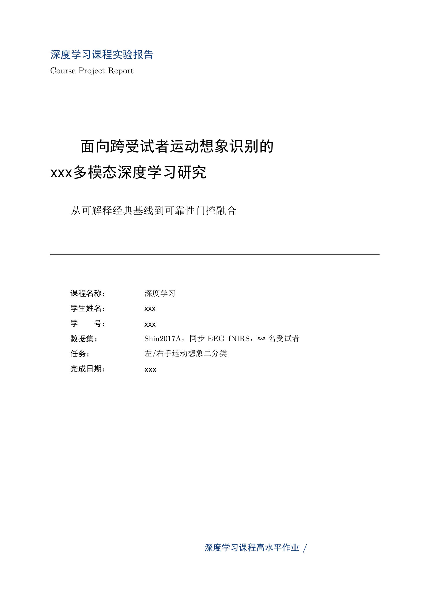
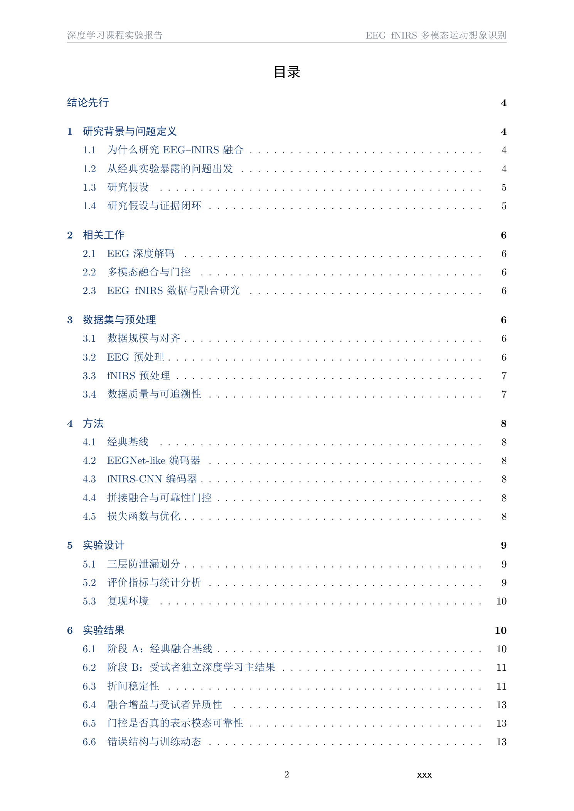
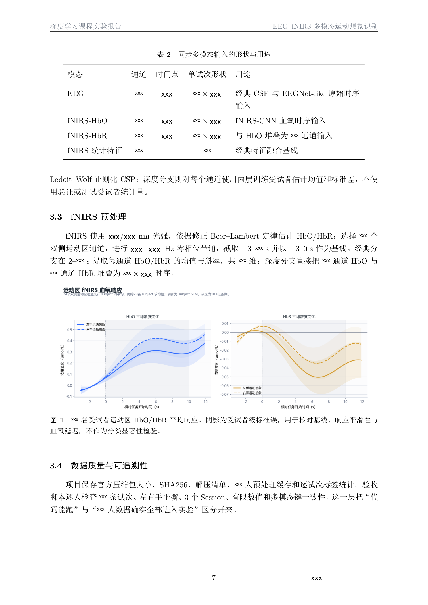
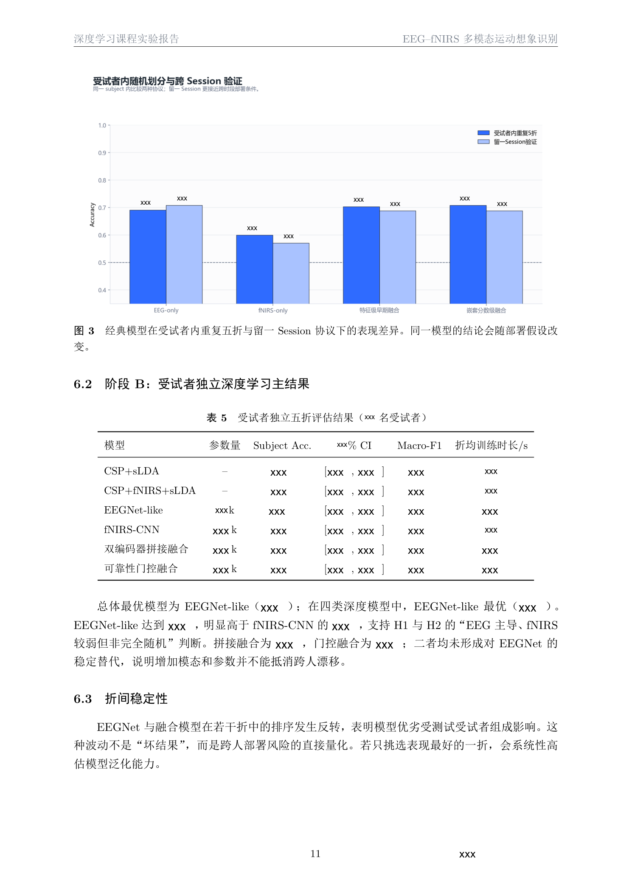
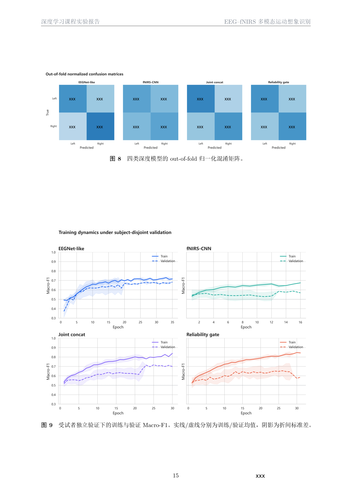
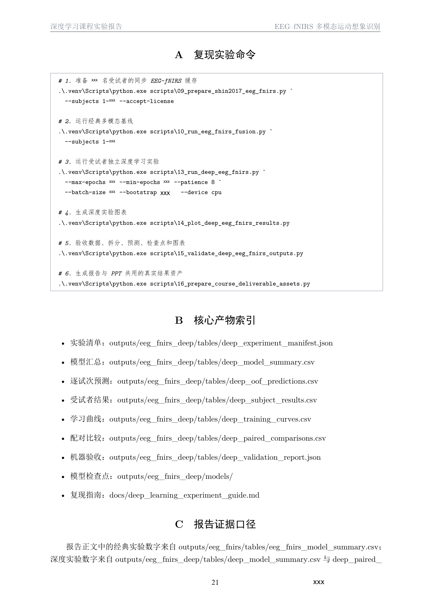

<div align="center">


**把课程材料，整理成有依据、有结构、经过逐页检查的学术报告。**


[在线阅读报告](demo/gallery.md) · [下载 PDF](https://github.com/gugu1031/gugu-report-skills/releases/download/v1.0.0/report-demo.pdf) · [下载技能包](https://github.com/gugu1031/gugu-report-skills/releases/latest) · [快速开始](#快速开始) · [完整工作流](SKILL.md)

</div>

---

## 从材料到交付

**gugu-report-skills** 是一套面向 AI 编程助手的报告制作技能，覆盖课程论文、实验报告、论文综述、方法比较与项目实践报告。

给它课程要求、评分标准、模板、PPT、论文、代码、实验结果或已有草稿，它会按一套明确的工作流程组织材料、撰写论证、完成 LaTeX 排版，并检查最终 PDF。

它把报告质量落实到几个具体动作：**先读要求，再理解证据；写清结论的边界；编译之后，逐页看实际效果。**

| 你提供的材料 | 技能关注的问题 | 预期交付 |
| :--- | :--- | :--- |
| 课程要求、评分表、模板 | 必答问题、结构、字体、页数与引用规范 | 要求对应的报告结构 |
| 论文、课件、已有草稿 | 核心问题、方法差异、论证与局限 | 有主线的学术正文 |
| 代码、数据、图表、实验截图 | 结果是否有依据、比较口径是否一致 | 图表、关键代码与结果分析 |
| 排版要求、修改反馈 | 页内留白、浮动体、代码跨页、参考文献 | `.tex`、PDF 与逐页检查记录 |

## 看看实际效果

下面展示的是同一份课程实验报告中的真实页面截图。

<table>
  <tr>
    <td width="50%" align="center"><a href="demo/screenshots/01-cover.png"></a><br><strong>01 / 封面与课程信息</strong></td>
    <td width="50%" align="center"><a href="demo/screenshots/02-contents.png"></a><br><strong>02 / 清晰的目录层级</strong></td>
  </tr>
  <tr>
    <td align="center"><a href="demo/screenshots/03-methods.png"></a><br><strong>03 / 图表与方法说明</strong></td>
    <td align="center"><a href="demo/screenshots/04-results.png"></a><br><strong>04 / 结果比较与分析</strong></td>
  </tr>
  <tr>
    <td align="center"><a href="demo/screenshots/05-training.png"></a><br><strong>05 / 训练动态与误差分析</strong></td>
    <td align="center"><a href="demo/screenshots/06-appendix.png"></a><br><strong>06 / 代码与附录组织</strong></td>
  </tr>
</table>

**[在线阅读完整的 24 页报告 →](demo/gallery.md)** · **[直接下载 PDF](https://github.com/gugu1031/gugu-report-skills/releases/download/v1.0.0/report-demo.pdf)**

在线阅读使用逐页图片。若 GitHub 的 PDF 预览无法加载，请通过上方下载链接保存后，用本机 PDF 阅读器打开。

> 这是经过脱敏的排版演示：个人信息及部分实验数字已替换为 `xxx`。正文、目录、标题和图片大部分保留，图表形状与趋势仍然可见。演示 PDF 采用页面图像封装，不提供可搜索文本层；其中的占位数值和命令不能用于复现实验。详细说明见 [演示文档说明](demo/README.md)。

## 为什么使用这套技能

- **按课程要求写。** 先识别题目、评分标准和模板，默认样式只补充未规定的细节。
- **按报告类型组织。** 实验报告突出步骤和结果，综述突出共同问题与方法差异，不机械套用同一套目录。
- **让证据支撑结论。** 使用已有实验与真实材料，不编造数据、截图或引用；明确区分已验证结果和后续设想。
- **把排版规则写清楚。** 封面、目录、正文分开；三线表、图注、代码行号和跨页行为有明确约束。
- **以最终 PDF 为准。** 检查全部页面，记录溢出、留白、孤立标题、代码断页与引用问题，再修改和复查。
- **交付可继续修改的材料。** 常规报告任务以 LaTeX 源码和 PDF 为主，并保留逐页检查记录。

## 快速开始

### 1. 安装技能

将本仓库放入你的技能目录，保证 `gugu-report-skills/SKILL.md` 位于该目录下一层。

**Windows / PowerShell**

```powershell
git clone https://github.com/gugu1031/gugu-report-skills.git (Join-Path $env:USERPROFILE '.agents\skills\gugu-report-skills')
```

**macOS / Linux**

```bash
git clone https://github.com/gugu1031/gugu-report-skills.git "$HOME/.agents/skills/gugu-report-skills"
```

也可以在 [Releases](https://github.com/gugu1031/gugu-report-skills/releases/latest) 下载精简技能 ZIP，解压后放入技能目录。精简包仅含技能文件，不包含演示 PDF 和截图。如果已有同名技能，请先备份，避免覆盖自己的修改。

以上路径依据 [Codex 官方技能文档](https://learn.chatgpt.com/docs/build-skills)。部分既有环境使用 `.codex/skills`；如果已能正常识别，无需搬迁或重复安装。安装后新建会话检查，未识别时重启应用，并以实际版本的配置为准。

### 2. 提供材料并调用

```text
使用 $gugu-report-skills，根据本目录中的课程要求、实验代码、结果图表
和现有草稿完成实验报告。

先核对必答问题与格式要求，再组织实验步骤、结果和分析。
不要编造缺失的实验结果。报告保存在原项目目录。
交付 LaTeX 源码、PDF 和逐页检查记录。
```

如果有明确的老师模板，补充一句：

```text
严格沿用老师提供的模板，默认样式只用于模板没有规定的部分。
```

需要更完整的提示词，可以直接使用 [可复用报告提示词](references/prompt-template.md)。

### 3. 准备运行环境

技能本身由 Markdown 和 YAML 文件组成，不包含模型服务或 LaTeX 编译器。实际生成报告时，需要助手能够读取项目文件、调用可用的 LaTeX 编译环境，并使用 PDF 提取或渲染工具完成检查。

现有默认样式包含 CTeX 与字体约定；不同系统上的字体和编译器需要按实际环境调整。具体规则见 [默认样式](references/default-style.md)。

## 工作流程

```text
课程要求 / 模板 / 原始材料
          ↓
识别报告类型，核对要求与证据
          ↓
确定结构，撰写正文与图表分析
          ↓
LaTeX 排版与编译
          ↓
提取文本，渲染并检查全部页面
          ↓
修正问题，交付源码 + PDF + 检查记录
```

技能还特别关注：目录独立成页、图表顺序、短代码块完整呈现、长表使用边界、正文留白、引用稳定性，以及修改后的相邻页面复查。

## 仓库结构

```text
gugu-report-skills/
├── SKILL.md                       # 核心工作流与质量要求
├── agents/
│   └── openai.yaml                # 技能展示信息与默认提示
├── references/
│   ├── default-style.md           # 默认排版与报告结构
│   └── prompt-template.md         # 可复用中文提示词
├── assets/
│   └── banner.png                 # README 标题图
├── demo/
│   ├── README.md                  # 演示文档说明
│   ├── gallery.md                 # 完整报告在线阅读
│   ├── pages/                     # 24 页图片，无需 PDF 预览器
│   ├── report-demo.pdf            # 24 页公开演示
│   ├── page-review.md             # 演示检查记录
│   └── screenshots/              # 6 张文档页面截图
└── README.md
```

精简技能包保留 `SKILL.md`、`agents/` 与 `references/`。本仓库不包含演示报告所对应的原始数据、实验代码、模型权重或未脱敏文档。

---

<div align="center">

**有依据的内容 · 清楚的论证 · 经得起检查的版面**

Maintained by [gugu1031](https://github.com/gugu1031)

</div>

